# Goose execution-time bar graphs

C and Goose measurements for problems 1–100 from the same recorded run.
Each panel shows ten problems with a shared logarithmic scale in [ms].
Bar height excludes the minimal no-op startup estimate. Diamonds mark zero
residuals at the lower edge. Compilation is excluded.

The earlier four-language figures used a different machine and remain separate.

## Problems 1 to 10

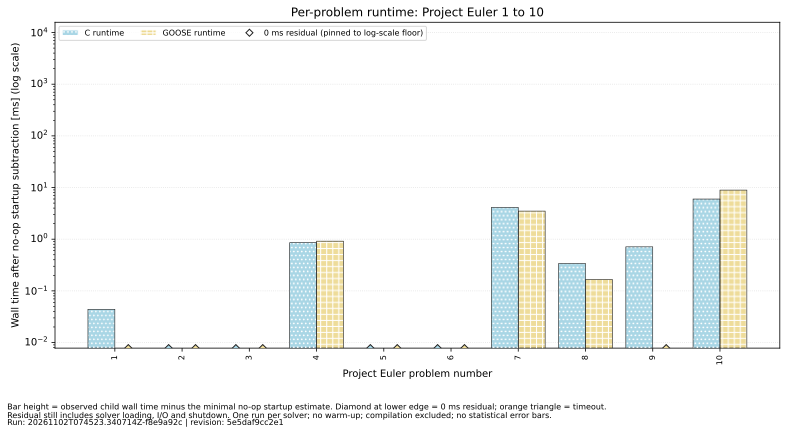

## Problems 11 to 20

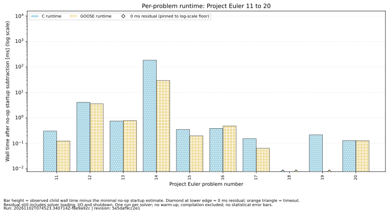

## Problems 21 to 30

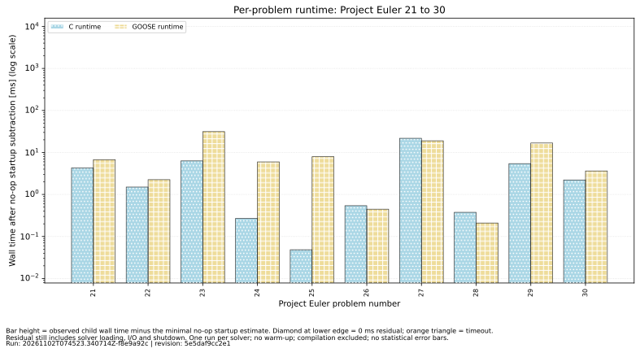

## Problems 31 to 40

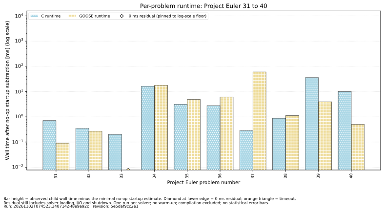

## Problems 41 to 50

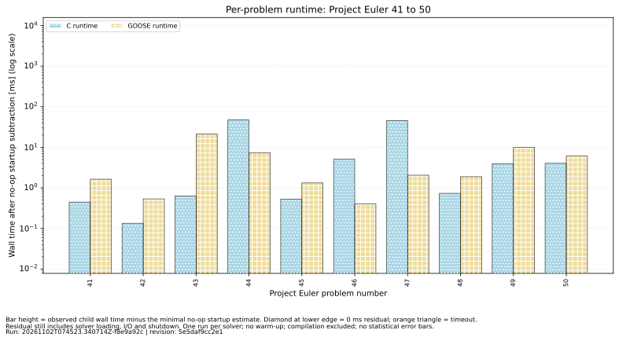

## Problems 51 to 60

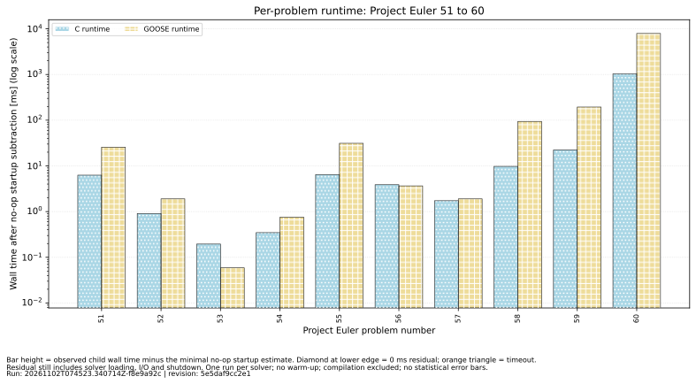

## Problems 61 to 70

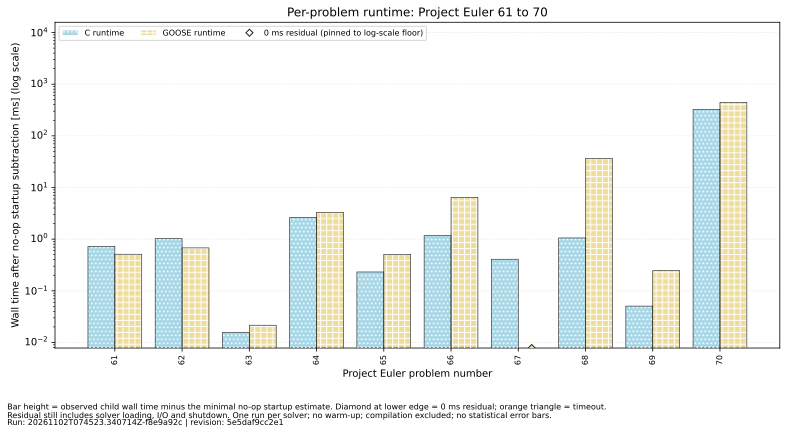

## Problems 71 to 80

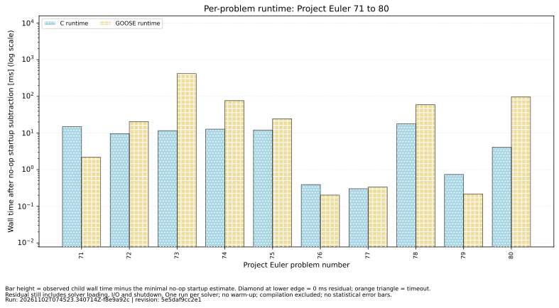

## Problems 81 to 90

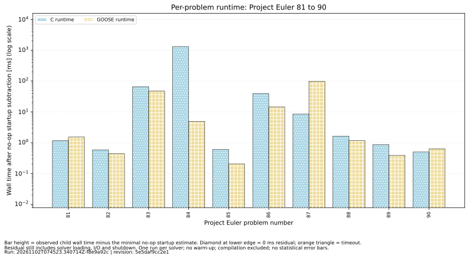

## Problems 91 to 100

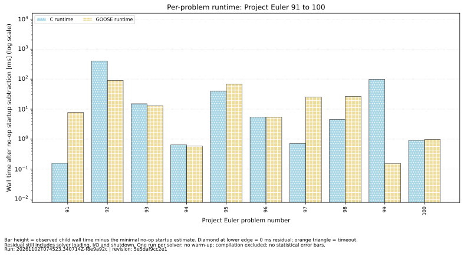

## Total for problems 1–100

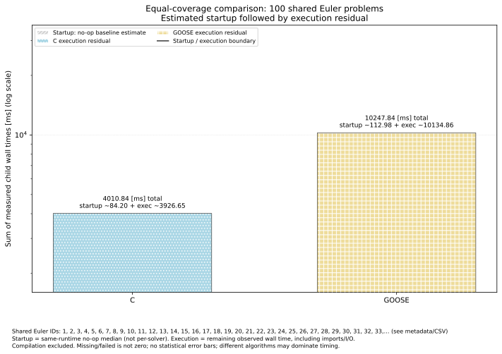

The total includes the startup segment. The per-problem figures omit it.

[Underlying measurements](../../../GOOSE_1_100.md).
